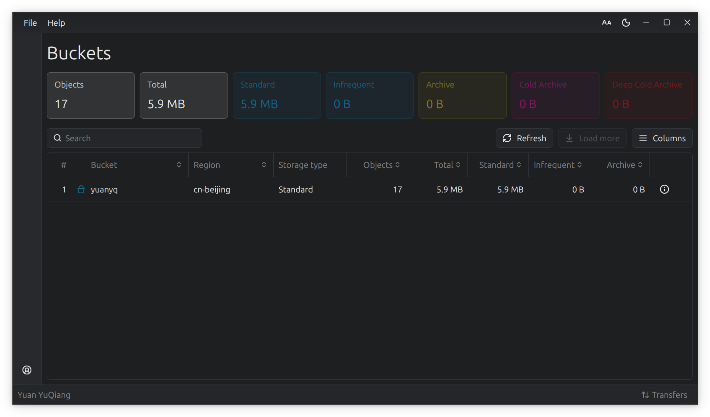

# Aliyun OSS GUI Client


[English](README.md) | [中文](README.zh-CN.md)

A cross-platform Aliyun OSS desktop client built with Rust and [GPUI](https://github.com/zed-industries/zed).
Multiple accounts, a bucket overview, object browsing and transfers — all in one window, with no browser engine and no Electron.



## Features

**Accounts**

- Multiple accounts side by side, switch with one click; AK/SK live in the OS keychain (macOS Keychain / Windows Credential Manager / Linux Secret Service) and are never written to disk

**Buckets**

- Lists every bucket with its region, storage class and object count, plus usage for each of the five storage classes (Standard / Infrequent Access / Archive / Cold Archive / Deep Cold Archive)
- The statistic columns are sortable
- A global summary of the statistics above

**Objects**

- Breadcrumb navigation; instant local filtering, and server-side prefix search on Enter
- Upload: pick files, pick a folder, or drag them straight in from your file manager
- Download: a single object, or a whole folder recursively
- Multi-select and batch delete, or delete one row at a time
- Object detail: inline preview for images; size, ETag, last modified and last accessed time, custom metadata, and one-click copy of a presigned URL

## Download

Prebuilt packages are on the [Releases](https://github.com/yuqiang-yuan/ossgui/releases) page.

| Platform | Package | Architecture |
| --- | --- | --- |
| macOS | `Ossgui_*.dmg` | Apple Silicon |
| Windows | `ossgui.exe` — portable, just run it | x64 |
| Linux | `.deb` / `.rpm` / `.AppImage` | x64 and arm64 |

## Build from source

You need a stable Rust toolchain (edition 2024; the current dependency tree requires 1.92 or newer).

```bash
git clone https://github.com/yuqiang-yuan/ossgui.git
cd ossgui
cargo run --release
```

On Linux you also need the X11 development packages, otherwise linking fails with `cannot find -lxkbcommon`:

```bash
sudo apt install libxkbcommon-dev libxkbcommon-x11-dev libxcb1-dev \
                 libfontconfig1-dev libfreetype6-dev
```

## Why this project

An experimental project for learning [GPUI](https://github.com/zed-industries/zed) and [GPUI-Kit](https://github.com/longbridge/gpui-kit).
It currently covers listing, upload, download, delete and account management: enough to be useful, but nowhere near a replacement for the console. Bucket-level management (creating, deleting, configuring buckets) is not implemented.

Why GPUI and GPUI-Kit?

1. As someone who has used Ubuntu as a daily driver for years, GPUI's cross-platform story is appealing.
2. I'm tired of how heavy browser-based GUIs are — Tauri and Electron alike.
3. GPUI-Kit ships a complete kit, including a consistent visual design. That saves a lot of wheel-reinventing. Thanks to Longbridge, and to @huacnlee (Jason Lee).
4. GPUI-Kit iterates fast and is very active. There are breaking changes, but I can live with that.
5. I'm not against AI — but before letting AI write code, I want to understand how to write this framework and these features by hand. Call it pure curiosity.

What I got out of this project:

1. How to use GPUI Kit's common components, and how components talk to each other.
2. How to change the color theme.
3. How to bridge a Tokio runtime under GPUI.
4. How to store secrets cross-platform.
5. How file dialogs differ between platforms.
6. How to package a desktop app for macOS, Windows and Linux.

## License

MIT
