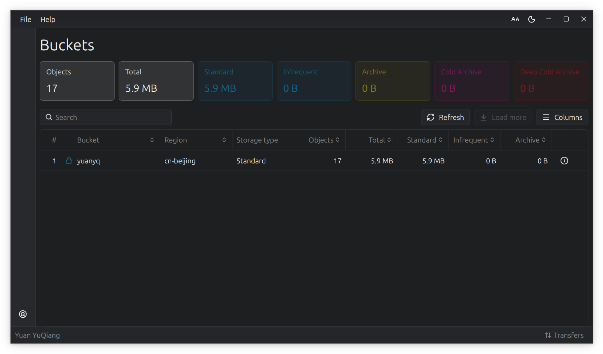

# Aliyun OSS 图形客户端


[English](README.md) | [中文](README.zh-CN.md)

用 Rust 和 [GPUI](https://github.com/zed-industries/zed) 写的阿里云 OSS 跨平台桌面客户端。
多账号、Bucket 概览、对象浏览和上传下载都在同一个窗口里完成 —— 没有浏览器内核，也没有 Electron。



## 功能

**账号**

- 多账号并存、一键切换；AK/SK 存进操作系统钥匙串（macOS Keychain / Windows 凭据管理器 / Linux Secret Service），不落盘

**Bucket**

- 列出全部 Bucket，带区域、存储类型、对象总数，以及标准 / 低频 / 归档 / 冷归档 / 深冷归档五种存储类型的用量
- 统计列可排序
- 全局统计汇总

**Object**

- 面包屑导航；本地即时过滤，回车走服务端前缀搜索
- 上传：选文件、选文件夹，或者直接从文件管理器拖进窗口
- 下载：单个对象，或整个目录递归下载
- 批量选择 / 批量删除，也能单独删
- 对象详情：图片类型直接预览；大小、ETag、最后修改与最后访问时间、自定义元数据，以及预签名 URL 一键复制

## 下载

预编译的安装包在 [Releases](https://github.com/yuqiang-yuan/ossgui/releases) 页面下载。

| 平台 | 安装包 | 架构 |
| --- | --- | --- |
| macOS | `Ossgui_*.dmg` | Apple Silicon |
| Windows | `ossgui.exe` —— 免安装，双击即用 | x64 |
| Linux | `.deb` / `.rpm` / `.AppImage` | x64 与 arm64 |

## 从源码构建

需要 Rust 稳定版工具链（edition 2024；当前依赖树要求 1.92 以上）。

```bash
git clone https://github.com/yuqiang-yuan/ossgui.git
cd ossgui
cargo run --release
```

Linux 上还要装 X11 相关的开发包，否则链接期会报 `cannot find -lxkbcommon`：

```bash
sudo apt install libxkbcommon-dev libxkbcommon-x11-dev libxcb1-dev \
                 libfontconfig1-dev libfreetype6-dev
```

## 为什么写这个

这是个实验项目，目的是学习 [GPUI](https://github.com/zed-industries/zed) 和 [GPUI-Kit](https://github.com/longbridge/gpui-kit) 。
功能上目前覆盖了列举、上传、下载、删除和账号管理：够用，但还没到"替代控制台"的程度。尤其是 Bucket 相关的功能（创建、删除、配置等），没有在这个工具实现。

选 GPUI 和 GPUI-Kit 的理由：

1. 多年以来都是以 Ubuntu 为主力系统，GPUI 的跨平台路线很对我的胃口。
2. 受够了浏览器套壳 GUI 的臃肿 —— Tauri 和 Electron 都一样。
3. GPUI-Kit 给了一整套组件和一致的视觉设计，省掉大量造轮子的时间。感谢 Longbridge 和 @huacnlee（Jason Lee）。
4. GPUI-Kit 迭代快、社区活跃。虽然会有破坏性更新，但可以接受。
5. 我不反对 AI —— 但在让 AI 写代码之前，我想先自己弄明白这套框架和这些功能该怎么写。纯粹的好奇心。

这个项目里实际学到的东西：

1. GPUI-Kit 常用组件的用法，以及组件之间怎么通信。
2. 怎么改配色主题。
3. 怎么在 GPUI 底下接一个 Tokio 运行时。
4. 怎么跨平台存密钥。
5. 各平台的文件选择器差异在哪。
6. 怎么给 macOS / Windows / Linux 打安装包。

## License

MIT
